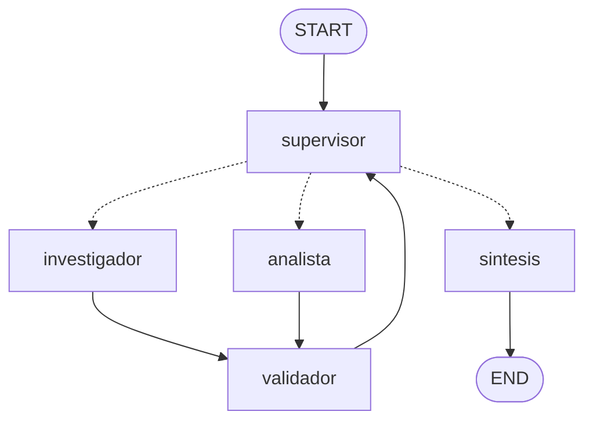

# Pre-Entrega 6 — Orquestador Multi-Agente Especializado

**AI Engineering — Coderhouse**

Orquestador de **análisis técnico de autos Volkswagen** con topología
**jerárquica**: un **Supervisor** recibe la consulta, delega en un
**Investigador** (búsqueda de datos) y en un **Analista** (cálculo), valida
cada aporte con un **Validador determinístico** y cierra con una **Síntesis**.

Integra lo construido en las entregas anteriores: el dataset de fichas
técnicas (Pre-Entregas 3 y 4), la "base de datos" de la concesionaria
(Pre-Entrega 5), la búsqueda híbrida con Pinecone (Pre-Entrega 4, opcional) y
el manejo multi-proveedor y resiliente del LLM (Pre-Entregas 1, 2 y 5).

## 1. Resumen

| Aspecto | Detalle |
|---|---|
| Topología | Jerárquica (patrón Supervisor) |
| Supervisor | Reglas determinísticas + LLM con rúbrica (`with_structured_output`, `Literal` de nodos) |
| Investigador | `create_agent` con `consultar_catalogo` y `buscar_en_fichas` |
| Analista | `create_agent` con una calculadora segura (`ast`, sin `eval`) |
| Validación | Validador determinístico: procedencia de cada dato y recálculo de cada cuenta |
| Estado | `EstadoOrquestador(MessagesState)` en `state.py`, con una parcela por agente |
| Límites | `MAX_PASOS=8`, `MAX_REPARACIONES=2` y escalado a revisión humana |
| LLM | OpenAI, Anthropic, Gemini u Ollama (por `.env`) |
| Tests | 22 tests con `pytest`, sin API key |
| Demo | `demo_delegacion.ipynb` y `demo.py` (traza en `trazas/`) |

## 2. El grafo



*(Generado desde el grafo compilado con `get_graph().draw_mermaid()`; la versión
PNG, con `draw_mermaid_png()`, está en `docs/grafo.png`.)*

- Las aristas punteadas son **condicionales**: el supervisor elige el destino y
  la función de ruteo devuelve un `Literal["investigador", "analista", "sintesis"]`.
- Los especialistas **nunca se comunican entre sí**: todo pasa por el supervisor.
- Todo aporte de un especialista pasa por el **validador** antes de volver al
  supervisor (la "puerta de calidad").

### Estructura del repositorio

| Archivo | Responsabilidad |
|---|---|
| `state.py` | Contrato del estado: modelos Pydantic, parcelas por agente y logs |
| `graph.py` | Nodos, reglas del supervisor, aristas, aislamiento de escritura |
| `agents/supervisor.py` | Supervisor (LLM con salida estructurada) |
| `agents/research_agent.py` | Investigador (`create_agent` + `response_format`) |
| `agents/analyst_agent.py` | Analista (`create_agent` + `response_format`) |
| `agents/synthesis_agent.py` | Síntesis final |
| `validation.py` | Validador determinístico |
| `prompts.py` | Todos los prompts, versionados con una huella |
| `tools/` | Catálogo, búsqueda en fichas, calculadora segura y lectura de evidencia |
| `traza.py` | Ejecución con log de "quién decidió qué y por qué" |
| `main.py` | Consulta interactiva o de una sola pregunta |
| `demo.py` | Los 5 escenarios de demostración, con traza en `trazas/` |
| `demo_delegacion.ipynb` | Notebook de demostración del flujo de delegación |
| `data/` | Fichas técnicas de los 7 modelos (Markdown) |

## 3. Por qué una topología jerárquica

El documento del módulo recomienda la jerarquía para *"workflows
deterministas o semi-deterministas"* y *"cuando la seguridad es crítica y
necesitás un validador final que revise todo antes de mostrarlo al usuario"*.
Este caso cumple las dos condiciones:

- **El flujo es predecible:** responder una pregunta técnica siempre requiere
  primero datos y después, si hace falta, un cálculo. No es un problema
  exploratorio en el que el orden de las tareas sea impredecible.
- **La exactitud es crítica:** una diferencia de potencia o un puntaje de
  seguridad mal calculados son peores que no responder. La jerarquía permite un
  único punto de control (supervisor + validador) por el que pasa todo antes
  de llegar al usuario.
- **Trazabilidad:** con un único decisor, cada paso queda registrado en un solo
  log, lineal y auditable. En una topología cooperativa, sin un rastro lineal,
  la depuración es mucho más difícil.

El riesgo de la jerarquía es que el supervisor sea un cuello de botella o "se
confunda". Se mitiga de tres formas: el supervisor no hace el trabajo de los
especialistas (solo decide y redacta instrucciones), ve un **resumen** del
estado y no las salidas crudas de las herramientas, y las decisiones críticas
(límites, reparaciones, escalado) las toman **reglas determinísticas**, no el LLM.

## 4. El supervisor: reglas determinísticas + LLM

Cada vez que interviene, el supervisor evalúa en orden:

1. **Límite de pasos** (`MAX_PASOS`): si se alcanzó, finaliza con lo obtenido.
   Evita el "supervisor infinito".
2. **Bucle de reparación:** si la última validación falló, le devuelve al
   especialista su output junto con el **error específico** del validador (no
   un "intentá de nuevo"). Si fue una excepción, lo reintenta.
3. **Escalado a revisión humana:** si un especialista ya usó sus
   `MAX_REPARACIONES` y sigue fallando, finaliza marcando
   `escalado_humano=True`, y la síntesis lo avisa. Evita el "bucle infinito de
   corrección".
4. **Si ninguna regla aplica, decide el LLM** con una rúbrica explícita
   (`prompts.SUPERVISOR`): investigar si faltan datos, analizar si faltan
   cálculos, y finalizar solo si todo lo que pide la tarea está validado.
5. **Guardas de suficiencia:** si el LLM intenta mandar al analista o
   finalizar sin ninguna investigación hecha, la decisión se corrige a
   `investigador`.

Cada decisión queda registrada en `decisiones`, con su **origen** (`regla` o
`llm`) y su **razón**.

## 5. Manejo de conflictos entre agentes

La clase advierte que ni el promedio ni la mayoría resuelven un conflicto: dos
agentes pueden alucinar lo mismo. Acá los conflictos se resuelven con
**procedencia verificada por código**:

- **Cada dato del Investigador tiene que estar respaldado por la evidencia.**
  Tiene que citar una fuente que sus herramientas realmente devolvieron, y su
  valor tiene que aparecer en el texto de esa fuente. El validador lee los
  números con el formato de los documentos (`89,88 %`, `2.566 mm`,
  `$29.900.000`). Una investigación **sin ningún dato** tampoco pasa: entra al
  bucle de reparación en vez de darse por buena.
- **El Analista no puede traer números propios.** Cada número de sus
  expresiones tiene que provenir de la investigación validada (con la
  excepción de 1, 2 y 100, para promedios y porcentajes) o del resultado de un
  cálculo anterior de la misma respuesta que ya pasó la verificación (encadenar
  cuentas es válido). El validador **recalcula** cada cuenta con la calculadora
  segura.
- **Aislamiento de escritura:** cada nodo es dueño de una parcela del estado
  (tabla de la sección 6), y `con_parcela()` en `graph.py` hace fallar al nodo
  que intente escribir fuera de la suya. Un agente no puede pisar el resultado
  de otro.
- **Si el conflicto no se resuelve** (el especialista sigue fallando después de
  las reparaciones), no se elige "al que suena mejor": se escala a revisión
  humana.

## 6. El estado compartido (`state.py`)

`EstadoOrquestador` hereda `messages` de `MessagesState` y suma campos con
dueño único:

| Parcela (dueño) | Campos | Contenido |
|---|---|---|
| Supervisor | `siguiente`, `instruccion`, `pasos`, `reparaciones`, `escalado_humano`, `decisiones` | Control del flujo y registro de decisiones |
| Investigador | `investigacion`, `evidencia` | `AporteInvestigacion` (datos con fuente) y salidas crudas de sus herramientas |
| Analista | `analisis` | `AporteAnalisis` (cálculos con expresión y resultado) |
| Validador | `validacion`, `validaciones` | Resultado de cada validación |
| Síntesis | `respuesta_final` | Respuesta al usuario |
| Compartido (solo agregar) | `contribuciones` | Qué aportó cada especialista, cuándo y si falló |

`decisiones`, `validaciones` y `contribuciones` usan el reducer
`operator.add`: se acumulan, no se sobrescriben. Así el estado final contiene la
historia completa de la ejecución, sin pérdida de contexto.

Los aportes de los especialistas son modelos **Pydantic** que se construyen
con el `response_format` de `create_agent`: si el LLM devuelve un campo
faltante o con tipo incorrecto, falla antes de entrar al estado.

## 7. Contexto acotado

Error a evitar: "Contaminación de Contexto". Ningún especialista ve la
conversación completa:

- el **Investigador** recibe solo la instrucción puntual del supervisor;
- el **Analista** recibe la instrucción y los **datos validados** (no los
  fragmentos crudos de las fichas);
- el **Supervisor** ve un resumen del estado, no las salidas de las herramientas.

Por eso el prompt del supervisor le exige redactar instrucciones
**autocontenidas**.

## 8. Herramientas

| Agente | Herramienta | Qué hace |
|---|---|---|
| Investigador | `consultar_catalogo` | Versiones con potencia, torque, caja y stock por sucursal (base de la Pre-Entrega 5: specs reales, stock ficticio). Acepta el modelo con la versión pegada (`Virtus Exclusive` → `Virtus`) |
| Investigador | `buscar_en_fichas` | Búsqueda en las fichas técnicas (Latin NCAP, dimensiones, historia) |
| Analista | `calculadora` | Aritmética segura con `ast`: rechaza código, potencias gigantes y división por cero |

`buscar_en_fichas` usa por defecto **BM25 local**, con el tokenizador para
español de la Pre-Entrega 4. Si la consulta nombra un modelo, los fragmentos de
su ficha reciben un **refuerzo suave**: sin él, "Latin NCAP del Nivus" traía
primero la ficha del Tera, que también menciona al Nivus. Es un refuerzo y no
un filtro duro, porque en la Pre-Entrega 4 el filtro duro fallaba con "el sedán
del Polo", cuya respuesta está en la ficha del Virtus.

Con `BUSQUEDA_BACKEND=pinecone`, el BM25 se combina por **RRF** con la búsqueda
vectorial en el índice de la Pre-Entrega 4 (sin reingestar nada). Requiere
`requirements-pinecone.txt`.

## 9. Cómo levantar el entorno

Requiere **Python 3.12**.

```bash
py -3.12 -m venv venv              # Windows; en Linux/Mac: python3.12 -m venv venv
source venv/Scripts/activate       # Git Bash; en Linux/Mac: source venv/bin/activate
python --version                   # tiene que decir 3.12.x
python -m pip install -r requirements.txt
cp .env.example .env               # completar la API key del LLM
```

```bash
python -m pytest -v                # 22 tests, sin API key
python main.py "¿Cuánta más potencia tiene el Virtus Exclusive que el Tera High?"
python demo.py                     # los 5 escenarios, con traza en trazas/
```

La notebook `demo_delegacion.ipynb` se abre en VS Code o Jupyter con el
intérprete del venv (por eso `ipykernel` está en `requirements.txt`).

**Costo:** `demo.py` hace unas 60 llamadas al LLM y la notebook unas 35. Con
`gpt-4o-mini` es cuestión de centavos de dólar; la capa gratuita de Gemini (20
pedidos por día) no alcanza para una corrida completa. Si el proveedor corta a
mitad de camino, la traza ya guardada no se pierde: `python demo.py --desde N`
retoma.

## 10. Demostración: los 5 escenarios

| # | Escenario | Qué demuestra | Respuesta esperada |
|---|---|---|---|
| 1 | Delegación completa (catálogo) | Supervisor → Investigador → Analista → Síntesis | 49 CV, 80 Nm y 3 unidades |
| 2 | Delegación completa (fichas) | La otra herramienta, y la lectura de `89,88 %` | 2,59 puntos |
| 3 | Falla de un especialista | El investigador falla (simulado) y el supervisor no se rompe | 80 Nm |
| 4 | Bucle de reparación | Cuenta mal hecha (simulada), detectada y reparada con el error específico | ≈ 132,32 % |
| 5 | Escalado a revisión humana | El analista se equivoca siempre (simulado) y se escala | 8 unidades, marcadas para revisión |

Las fallas se simulan con `simulacion` en la configuración de cada corrida
(`fallar_investigador`, `corromper_analisis`), sin variables globales. Es el
error a evitar "no probar el camino de fallo".

### Resultados de la corrida real

Corrida con `gpt-4o-mini` (temperatura 0) y prompts `v3`. La traza completa
("quién decidió qué y por qué", paso por paso) está en
`trazas/traza_orquestador.log`, y en formato estructurado en
`trazas/traza_orquestador.json`.

| # | Esperado | Respuesta final | Intervenciones | Decisiones LLM / regla | Validaciones fallidas | Escalado |
|---|---|---|---|---|---|---|
| 1 | 49 CV, 80 Nm, 3 unidades | ✅ 49 CV, 80 Nm y 3 unidades | 2 | 3 / 0 | 0 | no |
| 2 | 2,59 puntos | ✅ 2,59 puntos porcentuales | 2 | 3 / 0 | 0 | no |
| 3 | 80 Nm | ⚠️ Sin respuesta: escalado a revisión humana (ver hallazgos) | 3 | 1 / 3 | 3 | **sí** |
| 4 | ≈ 132,32 % | ✅ 132,32 %, tras reparar la cuenta corrupta | 3 | 3 / 1 | 1 | no |
| 5 | 8 unidades + escalado | ✅ 8 unidades, marcado para revisión humana | 4 | 2 / 3 | 3 | **sí** |

Lo que demuestra cada mecanismo en esta corrida:

- **Delegación** (1 y 2): el Supervisor resolvió cada tarea en dos
  intervenciones, Investigador y Analista, sin llamadas de más. El escenario 2
  usó la búsqueda en las fichas, y el Validador leyó `89,88 %` del texto.
- **Falla de un especialista** (3): el fallo simulado del Investigador no rompió
  al Supervisor: una regla lo reintentó.
- **Bucle de reparación** (4): el Validador detectó el 142,32 % alterado, y el
  Analista lo corrigió en un solo intento gracias al error específico
  (`recálculo ... (132.323)`).
- **Escalado** (5): tras 2 reparaciones fallidas, una regla cortó el bucle y la
  síntesis lo informó.
- **El Validador frenó una alucinación real** (3): un dato inventado por el LLM,
  no simulado, no llegó a la respuesta final (ver hallazgos).

### Hallazgos de las corridas reales

Los tests usan agentes falsos que siempre piden bien los datos. Las corridas con
`gpt-4o-mini` encontraron problemas que los tests no podían ver; cada uno se
corrigió y quedó cubierto por un test de regresión.

**Primera corrida (prompts `v1`): 3 de 5 escenarios correctos.**

| Escenario | Qué pasó | Causa | Corrección |
|---|---|---|---|
| 1 | 8 investigaciones sin datos y corte por `MAX_PASOS` | El Investigador pedía `"Virtus Exclusive"` y el catálogo solo aceptaba `"Virtus"` | El catálogo reconoce el modelo dentro del texto, y el prompt del Investigador lo indica |
| 1 | El supervisor reenviaba la misma instrucción una y otra vez | Una investigación **vacía** pasaba la validación "sin errores" | Una investigación sin datos no pasa: entra al bucle de reparación y, si no hay forma, escala |
| 2 | Escalado a revisión humana con la respuesta correcta | El Analista usó el resultado de su propia cuenta (2,59) en otra, y el validador lo tomó como número inventado | Se permite encadenar cuentas: un resultado anterior ya verificado es un número válido |
| 4 | 4 investigaciones hasta encontrar `"Vento GLI"` | La misma causa que el escenario 1 | La misma corrección |

**Segunda corrida (prompts `v2`): 4 de 5 escenarios correctos.**
El escenario 1 se resolvió en 2 intervenciones (antes, 8) y el 4 encontró los
datos al primer intento. Quedó un error en el escenario 2, el más instructivo:

- La tarea pedía **"puntos porcentuales de diferencia"** (una resta: 2,59).
- El Supervisor le encargó al Analista la **"diferencia porcentual"** (una
  relación: 2,88 %).
- El Analista calculó bien lo que le pidieron, así que el Validador lo aprobó.

**El Validador verifica la aritmética y la procedencia de cada número, no si se
eligió la cuenta correcta para la pregunta.** El error estaba en la traducción
de la tarea a una instrucción, un punto que ningún control determinístico ve.
Se corrigió en los prompts (`v3`): el Supervisor tiene que usar las mismas
palabras que la tarea para la magnitud pedida, y el Analista distingue
explícitamente "puntos porcentuales" (resta) de "porcentaje más" (relativo).
Detectar este tipo de error automáticamente requeriría un control semántico
adicional (por ejemplo, un LLM-juez que compare la pregunta con el cálculo), que
queda como mejora futura.

**Tercera corrida (prompts `v3`, la de la tabla): 4 de 5 escenarios correctos.**
El escenario 2 respondió 2,59 puntos porcentuales. En el escenario 3 apareció
un problema nuevo, y con él la mejor demostración del Validador en toda la
traza:

- El Supervisor le indicó al Investigador buscar el torque "en las fichas
  técnicas". Ese dato está en el catálogo; la ficha del Taos no lo menciona.
- El Investigador no lo encontró y, en vez de decirlo, devolvió
  `torque del Taos = 0 Nm`: **una alucinación real, no simulada**.
- El Validador la rechazó porque el 0 no aparece en `taos.md`. Tras las
  reparaciones el caso se escaló a revisión humana, y la síntesis respondió que
  el torque del Taos no estaba confirmado, en vez de dar un dato falso.

La respuesta esperada no se obtuvo, pero el sistema falló de forma segura.
Mejoras posibles, no aplicadas para no seguir ajustando prompts a una corrida
puntual: que el Supervisor no le indique al Investigador en qué fuente buscar
(es el Investigador quien elige la herramienta), y que el Investigador pruebe
la otra herramienta antes de declarar que un dato no existe.

La segunda corrida también encontró un problema de entorno: en Windows, al
redirigir la salida a un archivo (`python demo.py > salida.txt`), Python escribe
en `cp1252` y fallaba con los emojis de la traza. `demo.py` y `main.py` ahora
fuerzan UTF-8.

## 11. Tests

`tests/test_orquestador.py` reemplaza los cuatro componentes por dobles con
respuestas fijas, pero usa **evidencia real** (la salida de las herramientas
sobre el catálogo y las fichas). Corre sin API key y verifica:

- la delegación completa y el orden de los nodos;
- la reparación de un dato inventado y de una cuenta mal hecha, con el error específico;
- el rechazo de una fuente inventada y de un número que no vino de la investigación;
- el escalado a revisión humana tras `MAX_REPARACIONES`;
- que un especialista que falla no rompe al supervisor (excepción real y fallo simulado);
- el corte por `MAX_PASOS` de un supervisor que nunca finaliza;
- la guarda que impide analizar sin investigación;
- el contexto acotado de cada especialista;
- el aislamiento de escritura (un nodo que pisa otra parcela falla);
- la lectura de números con formato argentino, el refuerzo de búsqueda y la calculadora segura;
- el cableado real de `create_agent` + `response_format` con un LLM simulado;
- una regresión: la simulación de un análisis corrupto mutaba el objeto original
  (estado mutable compartido), bug encontrado y corregido durante el desarrollo;
- tres regresiones de la primera corrida real con `gpt-4o-mini` (sección 10): el
  catálogo que no aceptaba `Virtus Exclusive`, la investigación vacía que pasaba
  la validación y el cálculo encadenado que el validador rechazaba.

## 12. Errores a evitar

| Error | Cómo se evita |
|---|---|
| Supervisor infinito | `MAX_PASOS` (regla del supervisor) + `recursion_limit` de LangGraph |
| Bucle infinito de corrección | `MAX_REPARACIONES` + escalado a revisión humana |
| Contaminación de contexto | Cada especialista recibe solo su instrucción y los datos necesarios |
| Supervisor todólogo | El supervisor solo decide y redacta instrucciones: no busca ni calcula |
| Falta de contratos de interfaz | Aportes Pydantic + parcelas en `state.py` |
| Estado mutable compartido | Las actualizaciones vuelven por el grafo; nada se muta en el lugar |
| No versionar los prompts | `prompts.py`: versión + huella registradas en cada traza |
| Olvidar el diagrama | Sección 2 y `docs/grafo.png`, generados desde el grafo real |
| No probar el camino de fallo | Escenarios 3 a 5 y sus tests |

## 13. Cumplimiento de la consigna

| Requisito | Dónde |
|---|---|
| Topología jerárquica con Supervisor como router | `graph.py`, `agents/supervisor.py` |
| Agente de Búsqueda/Investigación con herramientas | `agents/research_agent.py`, `tools/catalogo.py`, `tools/busqueda.py` |
| Agente de Análisis/Cómputo | `agents/analyst_agent.py`, `tools/calculadora.py` |
| Estado compartido estructurado que rastrea quién aportó qué | `state.py` (parcelas + `contribuciones` + `decisiones`) |
| Estado que hereda de `MessagesState` | `state.py` (`EstadoOrquestador`) |
| El supervisor decide si finalizar o pedir un refinamiento | `graph.py` (`decidir_por_reglas`) + rúbrica en `prompts.py` |
| Ruteo con `Literal` en las aristas condicionales | `graph.py` (`enrutar`) y `state.py` (`DecisionSupervisor`) |
| Nodo de validación / rúbrica del supervisor | `validation.py` (nodo `validador`) + `prompts.SUPERVISOR` |
| Agentes con `create_agent` y herramientas acotadas | `agents/research_agent.py`, `agents/analyst_agent.py` |
| Diagrama del grafo en el README | Sección 2 y `docs/grafo.png` |
| Explicación de la topología y del manejo de conflictos | Secciones 3 y 5 |
| Video o notebook del flujo de delegación | `demo_delegacion.ipynb` |
| Corrida real con el LLM y su traza | Sección 10, `trazas/traza_orquestador.log` y `.json` |
